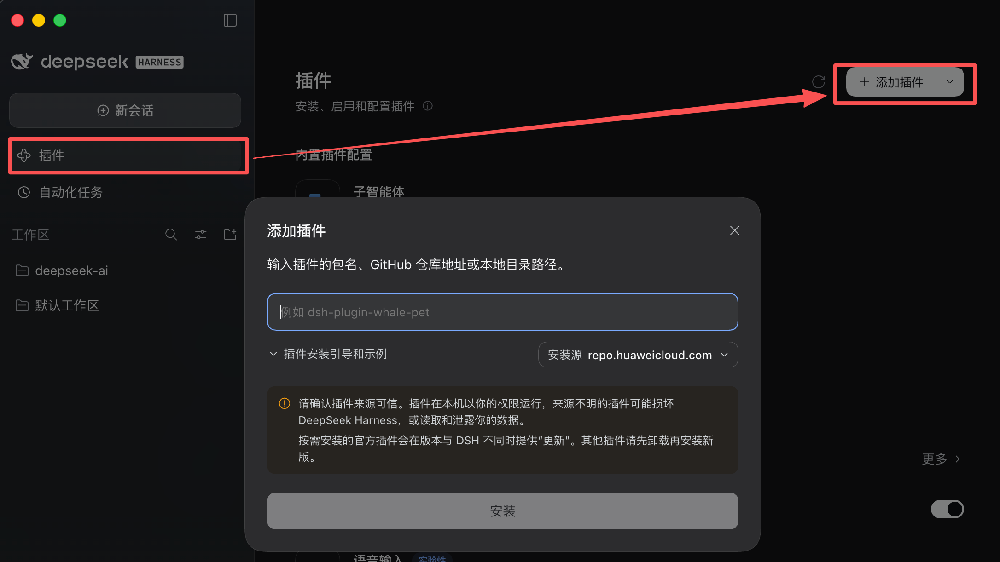
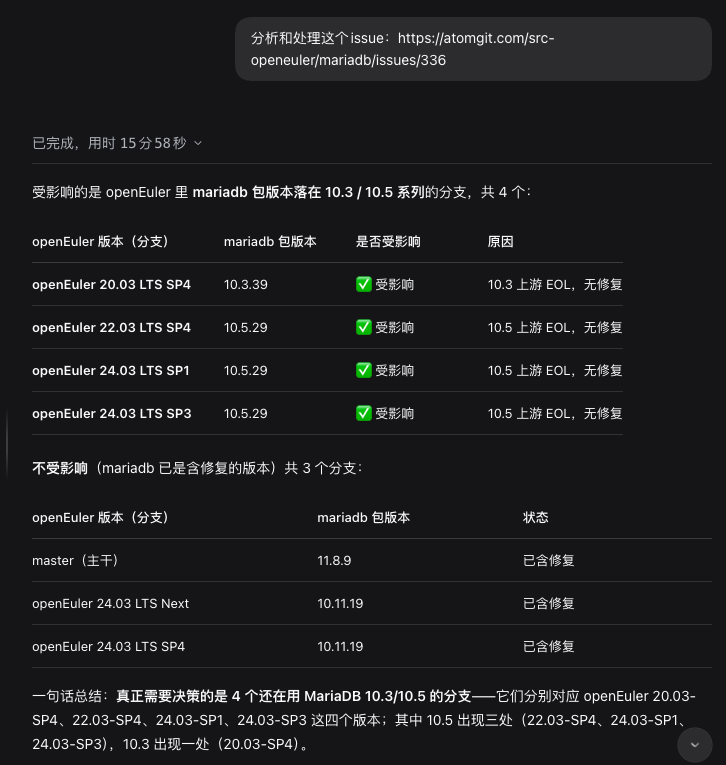
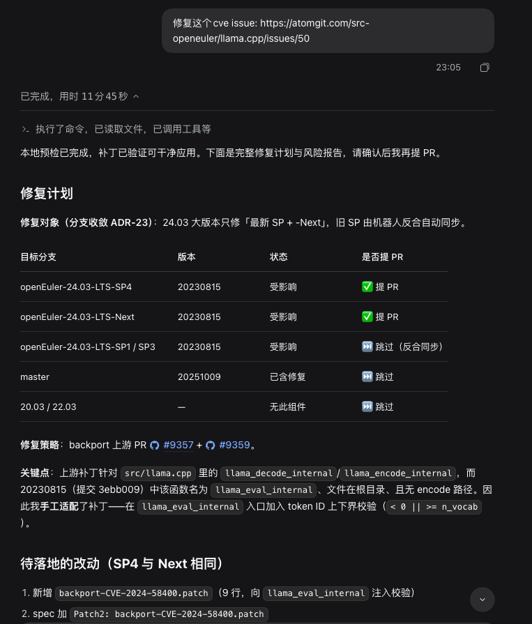
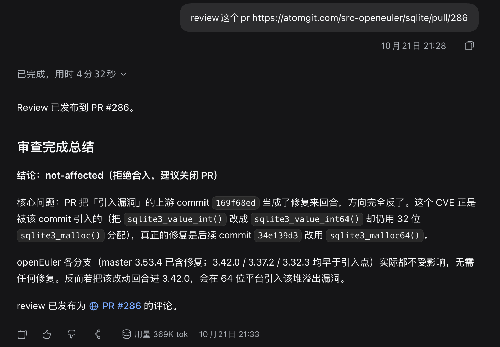
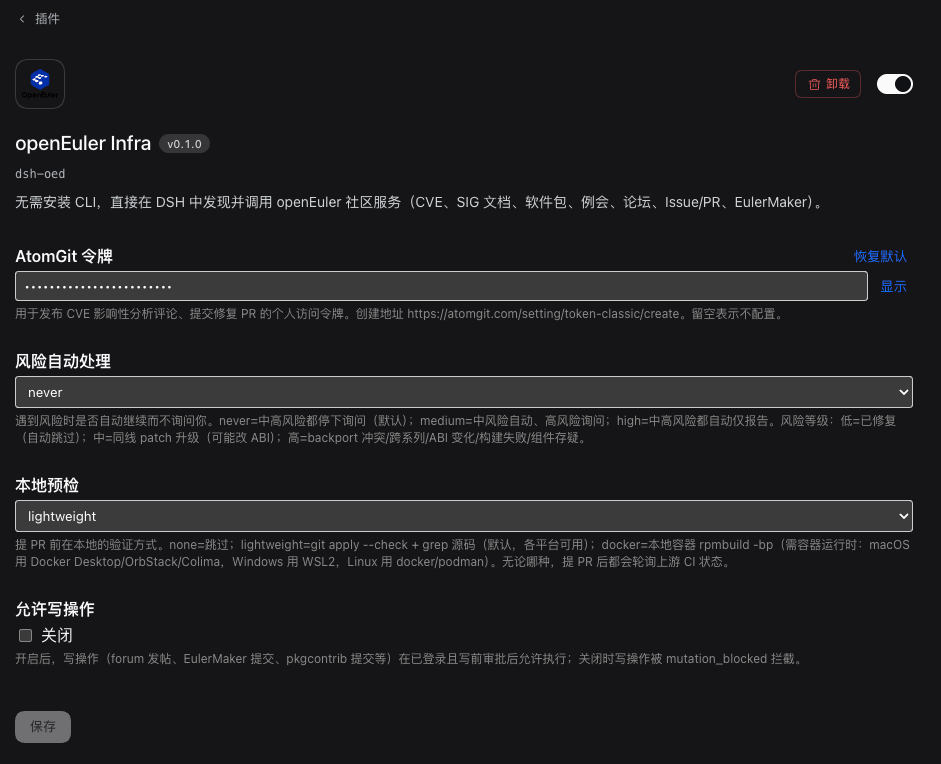

<p align="center">
  
</p>

<h1 align="center">oed-dsh</h1>
<h3 align="center">Let agents inside DeepSeek Harness call openEuler community services directly — no install, no CLI, no Python.</h3>

<p align="center">English · [中文](README.md)</p>

<p align="center">
  <a href="LICENSE"></a>
  <a href="#tools-and-skills"></a>
  <a href="#tools-and-skills"></a>
  
</p>

<p align="center">
  <a href="#quick-start"><strong>Quick start</strong></a> ·
  <a href="#capabilities"><strong>Capabilities</strong></a> ·
  <a href="#configuration"><strong>Configuration</strong></a> ·
  <a href="#docs"><strong>Docs</strong></a>
</p>

---

## What is this

`oed-dsh` is a plugin for [DeepSeek Harness](https://github.com/deepseek-ai/deepseek-harness). It lets agents inside DSH call community services behind the openEuler Infra gateway — CVE advisories, packages, SIG docs, meetings, forums, mail lists, issues/PRs, EulerMaker builds, AtomGit repos — **without installing Python or `oed-cli`**.

It wraps openEuler capabilities into three conversational CVE workflows, plus a runtime self-discovery tool set and oneid authentication.

## Quick start

### Install

**Option A: npm package (recommended after release)**

```bash
dsh plugin --profile web add oed-dsh
```

Installs the latest version by default; pin a version with `oed-dsh@<version>`.

**Option B: Git URL (Plugins page)**

```
Plugins → Add plugin → Git URL
https://atomgit.com/openeuler/oed-dsh.git
```

<p align="center"></p>

**Option C: local directory (development)**

Plugins → Add plugin → Local directory → select the `oed-dsh` directory.

After installing, enable the bundle and **restart DSH**. See [docs/INSTALL.md](docs/INSTALL.md).

### Try it

Ask directly in a new session — the agent auto-routes to the oed tools:

```text
List openEuler services
```

```text
Analyze https://atomgit.com/src-openeuler/ffmpeg/issues/267 and produce an impact-analysis comment
```

```text
Review https://atomgit.com/src-openeuler/postgresql-17/pulls/32
```

## Capabilities

| Capability                                       | What it does                                                                                                                           | One-liner trigger                   |
| ------------------------------------------------ | -------------------------------------------------------------------------------------------------------------------------------------- | ----------------------------------- |
| **CVE impact analysis** (`cve-triage`)           | Read a CVE issue, judge affected branches by "upstream range vs branch versions", render a cve-manager comment and post it via AtomGit | "Analyze `<issue link>` …"          |
| **CVE repair** (`cve-repair`)                    | For an affected CVE, draft the spec change (upgrade/backport) and risk report, then PR after review and poll CI                        | "Fix `<CVE issue>`"                 |
| **CVE PR review** (`cve-review`)                 | Review a CVE fix PR against a checklist (incl. sync-backport PRs), output approve / request-changes / needs-human                      | "Review `<PR link>`"                |
| **Generic gateway calls**                        | `oed_services` / `oed_operation_schema` / `oed_invoke` self-discover and call gateway operations at runtime                            | "Look up CVE-2019-10082"            |
| **Non-CVE community services** (`oed-community`) | Encapsulate SIG doc search, meetings, forums, packages and their quirks                                                                | "List meetings" · "Search SIG docs" |
| **Self-help & feedback**                         | `oed-help` answers usage/config/troubleshooting; `oed_diagnose` diagnoses local state + `oed_report_issue` files a bug/feature issue   | "How do I configure this plugin"    |
| **oneid auth**                                   | `oed_login` device-flow login for identity-gated services (EulerMaker submit, pkgcontrib submit, …)                                    | "Log in to openEuler"               |

**Read-only by default**: write operations (posting comments, raising PRs, posting reviews, gateway writes) need an AtomGit token or oneid login + pre-write approval.

## Screenshots

| CVE impact analysis                                                             | CVE repair                                                                     |
| ------------------------------------------------------------------------------- | ------------------------------------------------------------------------------ |
| [](docs/assets/cve-triage.png) | [](docs/assets/cve-repair.png) |

| CVE PR review                                                              | Config page                                                      |
| -------------------------------------------------------------------------- | ---------------------------------------------------------------- |
| [](docs/assets/cve-review.png) | [](docs/assets/config.png) |

## Tools and skills

**21 tools**: `oed_services` · `oed_operation_schema` · `oed_invoke` · `oed_login` · `oed_auth_status` · `oed_auth_logout` · `oed_diagnose` · `oed_report_issue` · `cve_issue` · `cve_triage_comment` · `cve_package_version` · `cve_post_comment` · `cve_fix_prepare` · `cve_repo_get_file` · `cve_fork_push` · `cve_open_pr` · `cve_build` · `cve_build_wait` · `cve_pr_get` · `cve_review_pr` · `cve_post_review`

**6 skills**: `oed-dsh` (routing) · `cve-triage` · `cve-repair` · `cve-review` · `oed-community` · `oed-help`

## Configuration

Configure in **Plugins → openEuler Infra config page** (AtomGit token / risk auto-approval / local verify / allow writes), see [docs/INSTALL.md](docs/INSTALL.md).

CI / headless environments can use env vars (oed-cli compatible): `ATOMGIT_TOKEN` · `OED_TOKEN` · `OED_APP_ID` · `OED_CACHE_DIR`.

## Docs

- [Install & verify](docs/INSTALL.md)
- [Requirements](docs/design/01-requirements.md) · [Architecture](docs/design/02-architecture.md)
- [CVE triage design](docs/design/features/cve-triage/design.md)
- [CVE repair design](docs/design/features/cve-repair/design.md)
- [CVE review design](docs/design/features/cve-review/design.md)
- [CVE repo ops design](docs/design/features/cve-repo-ops/design.md) (fork/push, ADR-32~37)
- [oneid auth design](docs/design/features/gateway-auth/design.md)

## Relationship to oed-cli

`oed-dsh` and [oed-cli](https://atomgit.com/openeuler/oed-cli) belong to the same oed family: `oed-cli` targets terminals / CI / Claude Code (Python), `oed-dsh` targets DSH (JavaScript). They share the gateway contract and release independently.

## License

[Mulan PSL v2](LICENSE) — free to use, modify and distribute.
