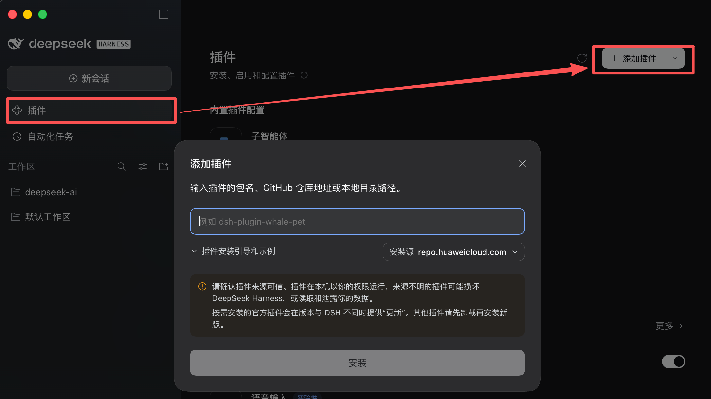
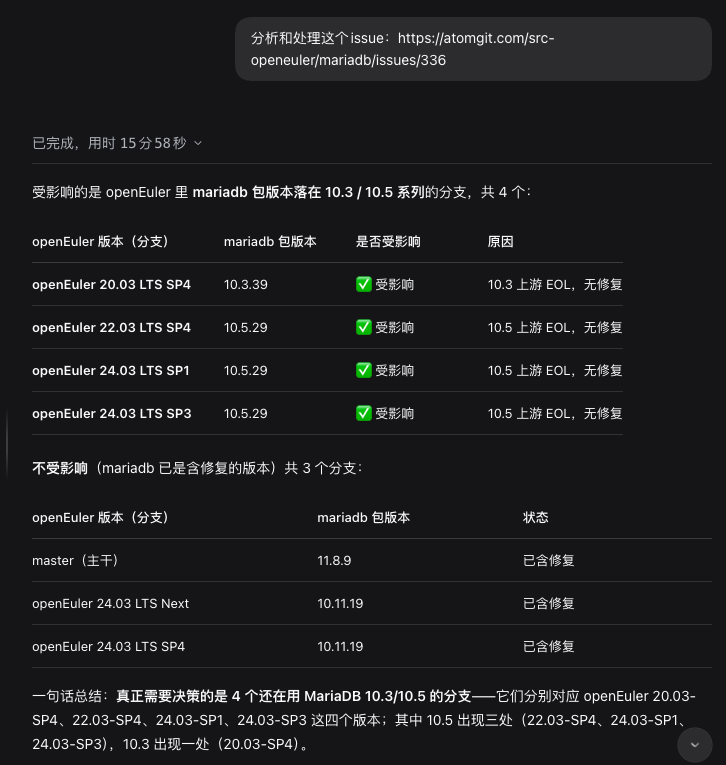
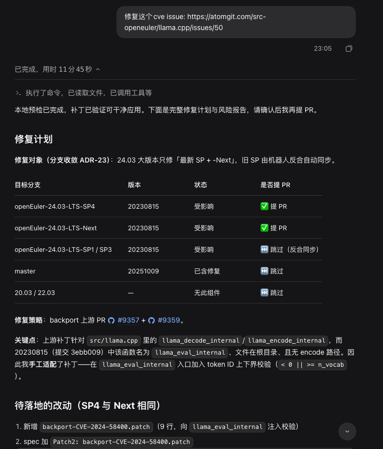
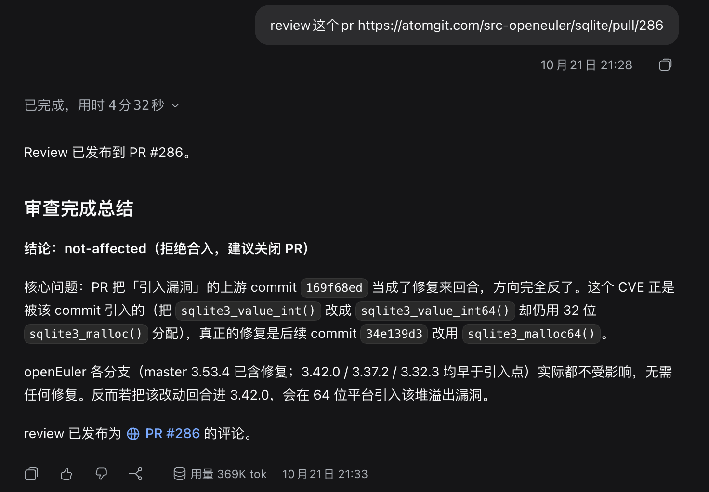
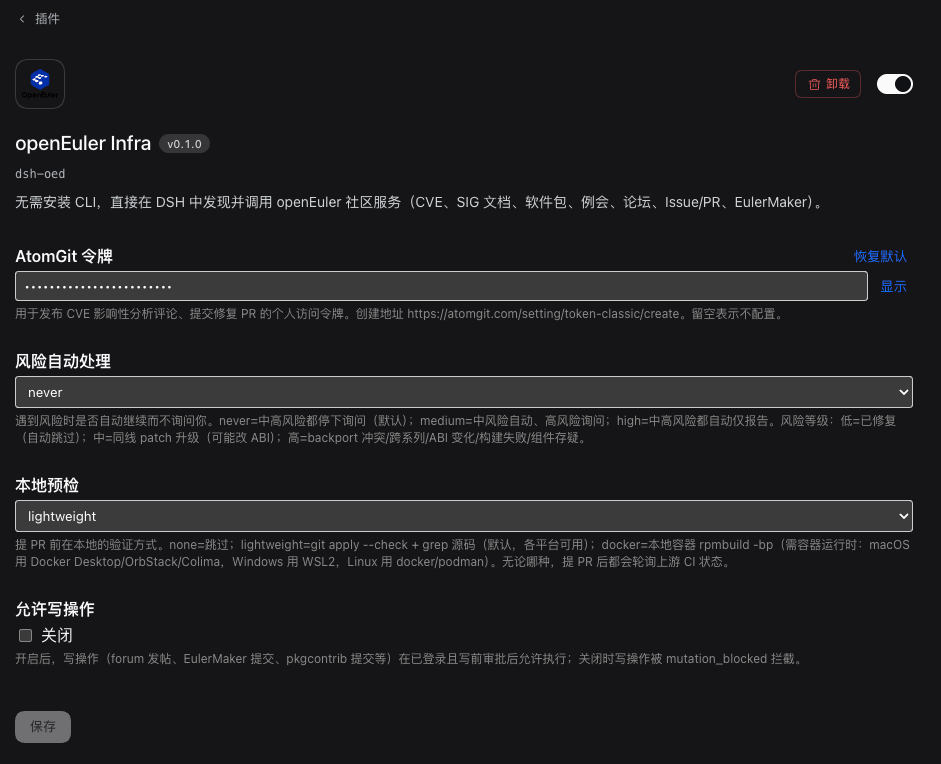

<p align="center">
  
</p>

<h1 align="center">oed-dsh</h1>
<h3 align="center">让 DeepSeek Harness 里的 Agent 直接调用 openEuler 社区服务——零安装、零 CLI、零 Python。</h3>

<p align="center">
  <a href="LICENSE"></a>
  <a href="#工具与技能"></a>
  <a href="#工具与技能"></a>
  
</p>

<p align="center">
  <a href="#快速开始"><strong>快速开始</strong></a> ·
  <a href="#能力"><strong>能力</strong></a> ·
  <a href="#配置"><strong>配置</strong></a> ·
  <a href="#文档"><strong>文档</strong></a>
</p>

---

## 这是什么

`oed-dsh` 是 [DeepSeek Harness](https://github.com/deepseek-ai/deepseek-harness) 的一个插件。它让 DSH 中的 Agent 直接调用 openEuler Infra 网关下的社区服务——CVE 安全公告、软件包、SIG 文档、会议、论坛、邮件列表、Issue/PR、EulerMaker 构建、AtomGit 仓库——**无需安装 Python，也无需 `oed-cli`**。

它把 openEuler 社区能力封装成三条可对话的 CVE 工作流，外加一套运行时自发现的通用调用工具，以及 oneid 认证。

## 快速开始

### 安装

**方式 A：npm 包（发布后，推荐）**

```bash
dsh plugin --profile web add oed-dsh@0.1.0
```

**方式 B：Git 地址（Plugins 页）**

```
Plugins → 添加插件 → Git 地址
https://atomgit.com/openeuler/oed-dsh.git
```

<p align="center"></p>

**方式 C：本地目录（开发调试）**

Plugins → 添加插件 → 本地目录 → 选中 `oed-dsh` 目录。

安装后启用该 bundle 并**重启 DSH**。详见 [docs/INSTALL.md](docs/INSTALL.md)。

### 试一句

新会话里直接问，Agent 会自动路由到 oed 工具：

```text
列出 openEuler 服务
```

```text
分析 https://atomgit.com/src-openeuler/ffmpeg/issues/267 并生成影响性分析评论
```

```text
审查 https://atomgit.com/src-openeuler/postgresql-17/pulls/32
```

## 能力

| 能力                               | 做什么                                                                                                       | 一句话触发                                   |
| ---------------------------------- | ------------------------------------------------------------------------------------------------------------ | -------------------------------------------- |
| **CVE 影响性分析**（`cve-triage`） | 读 CVE issue，按「上游漏洞区间 vs 各分支包版本」判定受影响分支，生成 cve-manager 规范评论并直连 AtomGit 发布 | 「分析 `<issue 链接>` 并生成影响性分析评论」 |
| **CVE 修复**（`cve-repair`）       | 对「受影响-正常修复」的 CVE 生成 spec 改动草稿（升级/backport）与风险报告，人审后提 PR 并轮询 CI             | 「修复 `<CVE issue>`」                       |
| **CVE PR 审查**（`cve-review`）    | 按清单审查 CVE 修复 PR（含 sync 反合 PR），输出 approve / request-changes / needs-human                      | 「审查 `<PR 链接>`」                         |
| **通用网关调用**                   | `oed_services` / `oed_operation_schema` / `oed_invoke` 运行时自发现并调用网关操作                            | 「查 CVE-2019-10082 公告」                   |
| **oneid 认证**                     | `oed_login` 设备流登录，为 identity-gated 服务（EulerMaker 提交、pkgcontrib 提交等）提供身份                 | 「登录 openEuler」                           |

**默认只读**：写操作（发评论、提 PR、发 review、网关写操作）需 AtomGit 令牌或 oneid 登录 + 写前审批。

## 效果截图

| CVE 影响性分析                                                                  | CVE 修复                                                                     |
| ------------------------------------------------------------------------------- | ---------------------------------------------------------------------------- |
| [](docs/assets/cve-triage.png) | [](docs/assets/cve-repair.png) |

| CVE PR 审查                                                                  | 配置页                                                      |
| ---------------------------------------------------------------------------- | ----------------------------------------------------------- |
| [](docs/assets/cve-review.png) | [](docs/assets/config.png) |

## 工具与技能

**18 个工具**：`oed_services` · `oed_operation_schema` · `oed_invoke` · `oed_login` · `oed_auth_status` · `oed_auth_logout` · `cve_issue` · `cve_triage_comment` · `cve_package_version` · `cve_post_comment` · `cve_fix_prepare` · `cve_repo_get_file` · `cve_fork_push` · `cve_open_pr` · `cve_build` · `cve_pr_get` · `cve_review_pr` · `cve_post_review`

**4 个技能**：`oed-dsh`（路由）· `cve-triage` · `cve-repair` · `cve-review`

## 配置

所有配置都在 **Plugins 页 → openEuler Infra 的配置页**，改完 Save 后新会话生效。

| 配置项           | 说明                                                                                                                                                                                                                               |
| ---------------- | ---------------------------------------------------------------------------------------------------------------------------------------------------------------------------------------------------------------------------------- |
| **AtomGit 令牌** | 发布 CVE 评论、fork 仓库/推送修复代码、提修复 PR、发 review 需要。在 [AtomGit 令牌页](https://atomgit.com/setting/token-classic/create) 创建个人访问令牌（勾选仓库写权限）后填入；留空则这些写操作会提示 `atomgit_token_missing`。 |
| **风险自动处理** | CVE 修复遇到风险时是否自动继续。`never` = 中高风险都停下询问（默认）；`medium` = 中风险自动、高风险询问；`high` = 中高风险都自动、仅报告。                                                                                         |
| **本地预检**     | 提 PR 前的本地验证。`lightweight` = `git apply --check` + grep 源码（默认，各平台可用）；`none` = 跳过；`docker` = 本地容器 `rpmbuild -bp`（需容器运行时）。                                                                       |
| **允许写操作**   | 网关写操作（EulerMaker 提交、pkgcontrib 提交、forum 发帖等）的开关。开启后还需 oneid 登录 + 写前审批；关闭时写操作被 `mutation_blocked` 拦截。                                                                                     |

### 环境变量（CI / 无界面场景）

与 oed-cli 兼容，已登录 oed-cli 的用户可直接复用凭据：

| 变量            | 作用                                                           |
| --------------- | -------------------------------------------------------------- |
| `ATOMGIT_TOKEN` | AtomGit 个人令牌，等价于配置页的「AtomGit 令牌」               |
| `OED_TOKEN`     | openEuler oneid access token，设了它就跳过 `oed_login`         |
| `OED_APP_ID`    | 自定义 oneid OAuth 应用标识；默认用内置的 openEuler Infra 应用 |
| `OED_CACHE_DIR` | oneid 凭据（`auth.json`）的存储目录                            |

> oneid 登录（`oed_login`）本身是**零配置**的：默认用内置的 Infra OAuth 应用，用户只需在浏览器点一下授权链接，无需手填任何认证参数。

## 文档

- [安装与验收](docs/INSTALL.md)
- [需求分析](docs/design/01-requirements.md) · [架构设计](docs/design/02-architecture.md)
- [CVE triage 设计](docs/design/features/cve-triage/design.md)
- [CVE repair 设计](docs/design/features/cve-repair/design.md)
- [CVE review 设计](docs/design/features/cve-review/design.md)
- [CVE 仓库操作设计](docs/design/features/cve-repo-ops/design.md)（fork/推送，ADR-32~37）
- [oneid 认证设计](docs/design/features/gateway-auth/design.md)

## 与 oed-cli 的关系

`oed-dsh` 与 [oed-cli](https://atomgit.com/openeuler/oed-cli) 同属 oed 家族：`oed-cli` 面向终端 / CI / Claude Code（Python），`oed-dsh` 面向 DSH（JavaScript）。二者共享网关契约、独立发版。

## License

[Mulan PSL v2](LICENSE) — 自由使用、修改与分发。
